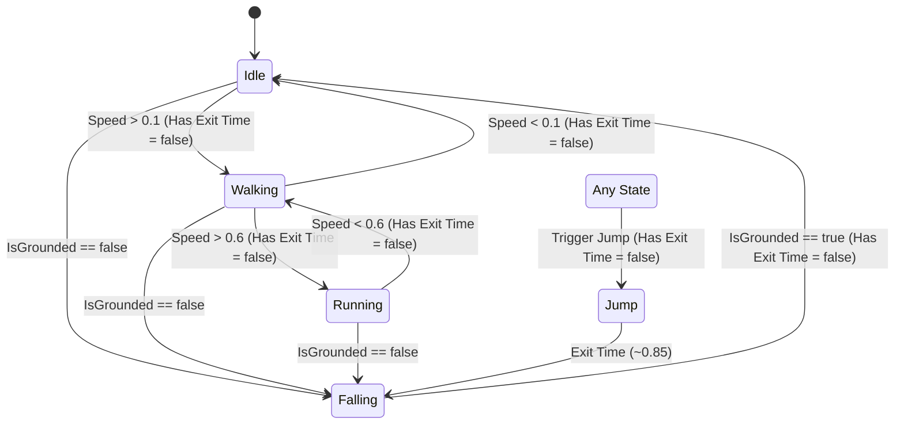
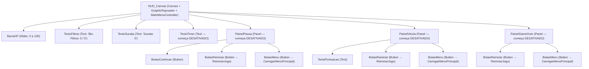

# Guia Técnico — Personagem (`ScrapE`) e Interface (`HUD_Canvas` & `MenuPrincipal`)

> **Escopo:** Referência rápida da parte do **Rafael** (Seções 5 e 6 do `CONTEXTO_PROJETO.md`), cobrindo o personagem **Scrap-E**, a máquina de estados de animação, o HUD, as telas de Menu/Pausa/Vitória/Game Over e o passo a passo de integração para o **Thiago** e o **Arthur**.

---

## 1. Resumo dos Entregáveis Concluídos

| Item (Seção 5) | Caminho no Projeto (`EcoScrapper/Assets/...`) | Detalhes Técnicos |
| :--- | :--- | :--- |
| **1 & 2. Clipes e Materiais do Scrap-E** | `Art/Personagem/Idle.anim`<br>`Art/Personagem/Walking.anim`<br>`Art/Personagem/Running.anim`<br>`Art/Personagem/Jump.anim`<br>`Art/Personagem/FallingIdle.anim`<br>`Art/Personagem/*.mat` | 5 animações completas (`Idle`, `Walking`, `Running`, `FallingIdle` com **Loop Time = true**; `Jump` com **Loop Time = false**, todas **In Place**). Materiais URP: `ScrapE_Amarelo.mat`, `ScrapE_JuntaEscura.mat` e `ScrapE_VisorAzul.mat` (LED emissivo). |
| **3. Controlador de Animação** | `Art/Personagem/ScrapE_Animator.controller` | Parâmetros exatos: `Speed` (`Float`), `IsGrounded` (`Bool`) e `Jump` (`Trigger`). Transições de locomoção sem *Has Exit Time* para resposta imediata ao `PlayerMovement.cs`. |
| **4. Prefab do Personagem** | `Prefabs/Personagem/ScrapE.prefab` | Tag `Player`, componente `Animator` apontando para `ScrapE_Animator`, **Apply Root Motion desligado (`m_ApplyRootMotion: 0`)** e malha 3D articulada (`Hips`, `Torso`, `Head`, `Visor_LED`, braços e pernas). |
| **5. Prefab de Interface (HUD)** | `Prefabs/UI/HUD_Canvas.prefab` | Todos os objetos com os nomes exatos do contrato da Seção 6 (`BarraHP`, `TextoFiltros`, `TextoSucata`, `TextoTimer` desativado, e painéis `PainelPausa`, `PainelVitoria`, `PainelGameOver` desativados com seus botões). |
| **6. Menu Principal, Cena de Teste e Build** | `Scenes/MenuPrincipal.unity`<br>`Scenes/Cena_Teste_Rafael.unity`<br>`Scripts/MainMenuController.cs`<br>`ProjectSettings/EditorBuildSettings.asset` | Menu com vitrine 3D giratória (`Transform.Rotate`), botões Iniciar, Controles, Eco-Timer e Sair. `EditorBuildSettings.asset` configurado com `MenuPrincipal` (índice 0) e `Nivel1` (índice 1). |
| **Extra: Automação Mixamo** | `Art/Personagem/Editor/MixamoSetupUtility.cs` | Menu de Editor `EcoScrapper → Rafael` para converter FBX do Mixamo (`Humanoid` + `Loop Time`) e religar o `ScrapE_Animator` em 1 clique. |

---

## 2. Arquitetura do `ScrapE_Animator` e do `HUD_Canvas`

### 2.1 Máquina de Estados (`ScrapE_Animator.controller`)

O `PlayerMovement.cs` envia a cada quadro os parâmetros `Speed` (`0` parado, `~0.5` andando, `~1.0` correndo com Shift), `IsGrounded` (`true`/`false`) e dispara `Jump` ao pressionar Espaço.



### 2.2 Hierarquia e Contratos do `HUD_Canvas.prefab`

Todos os nomes seguem rigorosamente a **Seção 6** do `CONTEXTO_PROJETO.md`:



---

## 3. Como Testar nas Cenas do Rafael

### 3.1 Testando `Cena_Teste_Rafael.unity`
1. Abra `Assets/Scenes/Cena_Teste_Rafael.unity` na Unity `6000.0.8f1`.
2. Pressione **Play**:
   - **W / S**: anda para frente e para trás (`Walking`).
   - **Segurar Shift + W**: corre (`Running`).
   - **A / D**: gira o robô no próprio eixo (`Transform.Rotate`).
   - **Espaço**: pula (`Jump` → `Falling` → `Idle` ao tocar o chão).
   - **Clique Esquerdo ou E**: dispara o Pulso Cinético (`InteractionController.cs`), arremessando os objetos marcados com `HeavyDebris`.
   - **Tecla R**: recarrega a cena imediatamente (`MainMenuController.ReiniciarJogo()`).
3. Para inspecionar os painéis da UI em execução, expanda o `HUD_Canvas` na Hierarchy e marque o checkbox de ativação de `PainelPausa`, `PainelVitoria` ou `PainelGameOver`. Os botões `BotaoReiniciar` e `BotaoMenu` já estão conectados ao `MainMenuController`.

### 3.2 Testando `MenuPrincipal.unity`
1. Abra `Assets/Scenes/MenuPrincipal.unity` e pressione **Play**.
2. Verifique:
   - O robô **Scrap-E** gira continuamente no pedestal da vitrine 3D à direita (`MainMenuController.Update` com `Transform.Rotate`).
   - **Botão Eco-Timer**: alterna `MainMenuController.useEcoTimer` entre `ATIVADO (3 MIN)` e `DESATIVADO`.
   - **Botão Controles**: abre e fecha o `PainelControles` com a tabela de comandos.
   - **Botão Iniciar**: carrega a cena `Nivel1` (`SceneManager.LoadScene("Nivel1")`).
   - **Botão Sair**: executa `Application.Quit()` e registra log no Console.

---

## 4. Guia de Integração para Thiago e Arthur (`Nivel1.unity`)

### Passo 1 — Integrar o `ScrapE.prefab` no `Player` (Thiago / Arthur)
1. Na cena `Nivel1.unity` (ou `Cena_Teste_Thiago.unity`), localize o objeto `Player` que possui `Rigidbody`, `CapsuleCollider`, `PlayerMovement` e `InteractionController`.
2. Desative o componente `MeshRenderer` da cápsula provisória do `Player` (mantenha o `CapsuleCollider` e o `Rigidbody` no `Player` pai).
3. Arraste `Assets/Prefabs/Personagem/ScrapE.prefab` para **dentro** do objeto `Player` como filho:
   - `Position`: `(0, -1, 0)` (alinhando os pés do robô com a base da cápsula).
   - `Rotation`: `(0, 0, 0)`.
4. Selecione o objeto `Player` e, no componente `PlayerMovement`, arraste o filho `ScrapE` para o campo **`Animator`**.

### Passo 2 — Integrar o `HUD_Canvas.prefab` na Cena (Thiago / Arthur)
1. Arraste `Assets/Prefabs/UI/HUD_Canvas.prefab` para a raiz da Hierarchy da `Nivel1.unity`.
2. Confirme que há um objeto `EventSystem` na cena (caso não exista, crie em `GameObject → UI → Event System`).
3. No script `UIManager` / `GameManager` do Thiago, basta referenciar os objetos filhos do `HUD_Canvas` pelos nomes combinados na Seção 6 (`BarraHP`, `TextoFiltros`, `TextoSucata`, `TextoTimer`, `PainelPausa`, `PainelVitoria`, `PainelGameOver`).
4. Para verificar se o jogador ativou o Eco-Timer no Menu Principal, consulte a variável estática `MainMenuController.useEcoTimer` no `Start()` do `GameManager`:
   ```csharp
   if (MainMenuController.useEcoTimer)
   {
       textoTimer.gameObject.SetActive(true);
   }
   ```

---

## 5. Como Trocar a Malha Articulada por FBX do Mixamo (Opcional)

O projeto já funciona 100% fora da caixa com a malha 3D articulada do `ScrapE.prefab` e os 5 clipes nativos em `Assets/Art/Personagem/`. Caso o Rafael queira substituir pelo **Y Bot** baixado do Mixamo:

1. Baixe do Mixamo os arquivos `.fbx` para a pasta `Assets/Art/Personagem/`:
   - Modelo base ou animações com nomes contendo `Idle`, `Walking` (*In Place* marcado), `Running` (*In Place* marcado), `Jump` e `Falling Idle`.
2. No topo da Unity, clique em:
   - **`EcoScrapper → Rafael → 1. Configurar FBX Mixamo (Humanoid + Loop)`**
   - Isso configura automaticamente todos os `.fbx` de `Assets/Art/Personagem/` para `Animation Type = Humanoid`, ativa `Loop Time` em `Idle`, `Walking`, `Running` e `Falling`, desativa `Loop Time` em `Jump` e trava a rotação/altura da raiz.
3. Em seguida, clique em:
   - **`EcoScrapper → Rafael → 2. Reconstruir ScrapE_Animator`**
   - O utilitário substitui automaticamente os clipes dos 5 estados (`Idle`, `Walking`, `Running`, `Jump`, `Falling`) pelos clipes dos arquivos `.fbx` importados, preservando todos os parâmetros (`Speed`, `IsGrounded`, `Jump`) e transições.
4. Caso use a malha do `Y Bot` dentro do `ScrapE.prefab`, aplique o material `Assets/Art/Personagem/ScrapE_Amarelo.mat` na superfície (`Alpha_Surface`) e `ScrapE_JuntaEscura.mat` nas juntas (`Alpha_Joints`), mantendo **Apply Root Motion** desmarcado no `Animator`.
